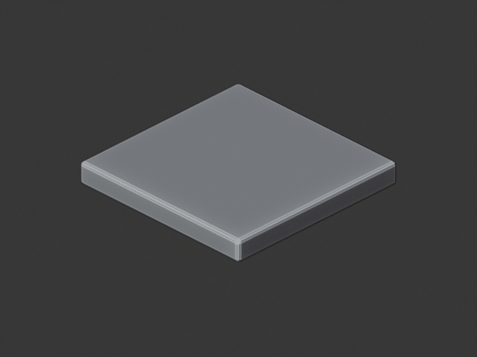
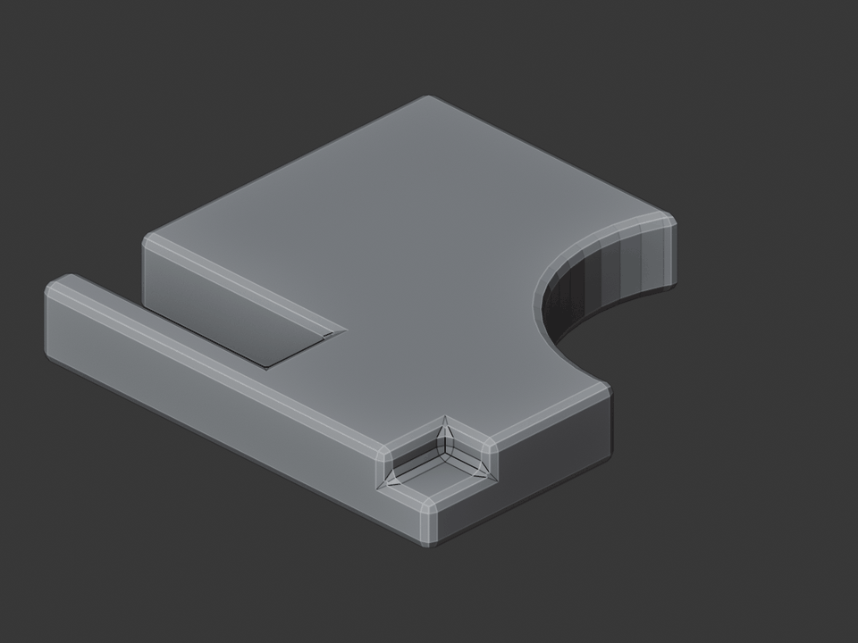
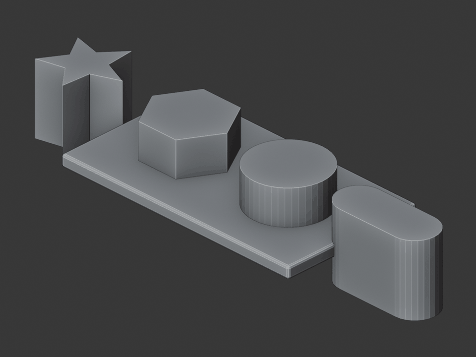
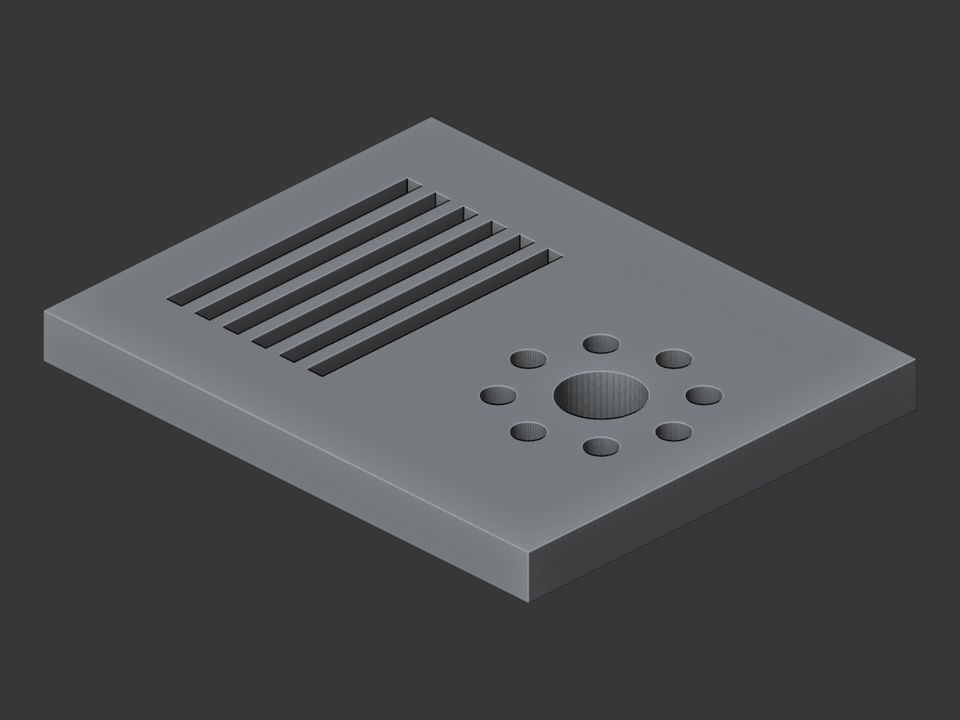
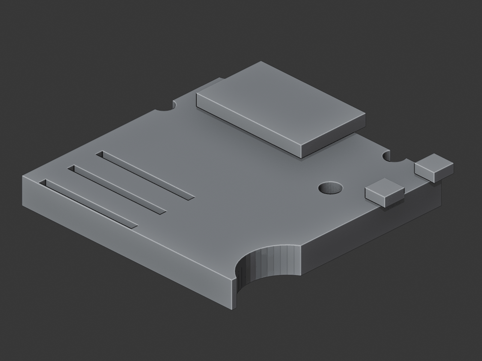
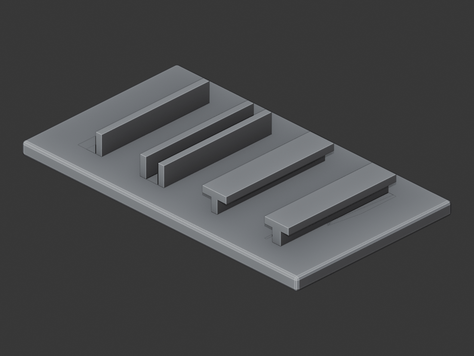
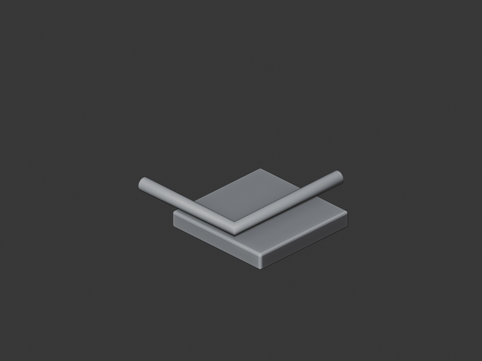
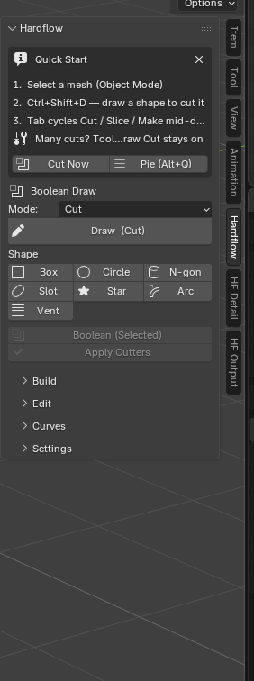

# Hardflow

**Free, open-source hard-surface modeling for Blender.**

Draw a shape on your model and it cuts. Add panel lines, vents, bolt circles,
decals and kitbash parts. Push, pull and bevel without leaving Object Mode.
One GPLv3 add-on instead of five paid ones.

## See it in action

  
   Boolean details cut and added one group at a time, then a turntable — every frame is real Hardflow output.

<table>
<tr>
<td width="50%"> <b>Draw-to-cut booleans</b> — a slot, a radius and a notch cut straight into a panel.</td>
<td width="50%"> <b>Shape library</b> — Box / Circle / N-gon / Slot / Star / Arc footprints.</td>
</tr>
<tr>
<td width="50%"> <b>Vents &amp; bolt circles</b> — one drawn rectangle becomes a louvre grill; one hole becomes a radial array.</td>
<td width="50%"> <b>Rapid detailing</b> — raised bays, vent slots, ports and bolt holes.</td>
</tr>
<tr>
<td width="50%"> <b>Sweep / Follow-Me</b> — L, U, T and I sections swept along a path.</td>
<td width="50%"> <b>Pipes &amp; cables</b> — a profile draped along the surface.</td>
</tr>
</table>

Every image is real Hardflow output — geometry built by the add-on's own
boolean, shape and curve tools, rendered in Blender's Workbench.

## Install

Blender 4.2 or newer:

**Edit ▸ Preferences ▸ Get Extensions ▸ (top-right ⌄) ▸ Install from Disk** →
pick the `hardflow` zip.

## Your first cut (60 seconds)

1. Add a cube and stay in **Object Mode**, with the cube selected.
2. Press **Ctrl+Shift+D** (or **Alt+Q** → *Cut*).
3. Drag a box on the front face. Release. The hole is cut. (Prefer
   click-click? That still works: click one corner, click the other.)
4. Still drawing? **Tab** switches Cut → Slice → Make → Join → Intersect →
   Face → Knife, and **Q W E R T Y U I** switch the shape.

Cutting a row of holes? Pick **Hardflow Draw Cut** from the toolbar (**T**)
instead: it stays armed, so every cut is just another click, and it keeps the
array, mirror and inset you dialed in. The N-panel **Mode** dropdown drives it.

Everything also lives in the sidebar (**N**), the **Alt+Q** pie menu and the
3D-View header menu, so you never have to memorise a key to find a tool. The
sidebar is split the way the work goes: **Hardflow** to model, **HF Detail**
for decals and kit parts, **HF Output** to finish and hand off.
The three global keys: **Alt+Q** pie · **Ctrl+Shift+D** draw · **Alt+X** mirror.

## What you can do

**Cut and build.** Draw Box / Circle / Polygon / N-gon / Slot / Star / Arc /
Vent footprints straight onto a surface and cut, slice, union, intersect or
score them. Type a number while drawing to lock an exact size. The grid snaps in
real meters, not screen pixels, so a 20 mm hole is 20 mm from any camera angle.
The real boolean result previews live while you draw. Drop Cube / Plane
/ Cylinder / Cone / Sphere / Tube starters to model on.

**Detail fast.** Array a cut along an axis or spin it into a **bolt circle**,
mirror it across the model, inset or bevel the cut, and stamp the last shape
again with one key. The **Vent** shape turns one drawn rectangle into a full
louvre grill. **Panel Lines** sweep selected edges into a recessed seam or a
raised weld bead.

**Mirror in one press** (**Alt+X**). Model half a part; Hardflow picks the
mirror axis from the way you are looking, keeps the half you can see, and drops
a live Mirror into the right place in the modifier stack — or, with
*Bisect+Mirror*, welds it into real symmetric geometry. Mirror about the object
origin, the 3D cursor, or another object entirely.

**Model directly.** **Push/Pull** a face along its normal with grid snap,
numeric entry and vertex/edge inference — and with Manifold on, pushing inward
*cuts* the volume instead of burying walls inside the mesh. **Offset** insets a
face border and can chain straight into a recess or a raised panel. **Edge
Bevel** and **Loop Cut** work in Object Mode, on a picked edge or its whole
loop, right through subdivision and other modifiers. **Smart Bevel** adds the
support loops that keep the edge crisp under Subdivision.

**Grab handles in the viewport.** Opt-in gizmos (Hardflow ▸ Settings ▸
Gizmos, or pick the
matching tool from the toolbar): move/rotate/scale, a bevel-width handle,
Push/Pull on the selected faces, **mirror plane** handles you click to mirror
across an axis, an **Offset ring** you drag inward to inset a face, and a
**loop slide** handle.

**Snap precisely.** Lock to corners, edge midpoints or along an edge, with
colour-coded cursor feedback (🟡 corner · 🟢 midpoint · 🔵 on edge). Hold
Shift for angle steps, cycle the drawing plane between view / surface /
selected edges / X / Y / Z, and drop reference grids and guide lines to model
against.

**Stay non-destructive.** Press **N** and the cut leaves a live boolean modifier
instead of applying; cutters are parked in their own collection, listed in the
N-panel, and can be shown, re-selected, re-ordered or baked later. Booleans pick
their own solver, retry on failure, and tell you *which* geometry broke instead
of silently doing nothing.

**Bake the detail down.** **Bake High to Low** takes your detailed mesh onto
the game mesh through a real **cage** — a copy of the low poly pushed out along
its normals — so the rays stay parallel across bevelled corners instead of
fanning out and smearing the normal map. The cage is built for you, checked
against the high poly and widened if it falls short. Normal, AO, roughness or
combined.

**Unwrap along your cuts.** On a boolean model the UV seams belong on the cut
boundaries — and Hardflow already marked those while cutting, so
**Hard-Surface Unwrap** reads its own marks instead of guessing: seams, unwrap,
even out the island scale and pack with padding you set in *pixels*. Turn the
angle fallback off and only your cuts become seams.

**Hand it to an engine.** The **HF Output ▸ Game-Ready** panel checks the things that bite
you after export — unapplied scale, inverted normals, non-manifold shells,
n-gons, loose geometry, missing UVs and texel density — and puts a Fix button
next to each one it can safely repair. Non-manifold geometry is selected for
you rather than silently "fixed", because that one is a modelling decision.

**Asset Shelf.** The decals and kit parts also live in Blender's own asset
shelf — the wide preview strip along the bottom of the viewport (*View ▸ Asset
Shelf*). Click a decal to start sticking it, click a part to place it. Your own
image and object assets show up there alongside them.

**Drag and drop.** Drag a PNG out of your file manager onto a model and it
becomes a decal under the cursor; drag a `.blend` and it becomes an INSERT.
The drop starts the normal placement tool — wheel to scale, `[ ]` to roll,
click to place — so it is the fast way in, not a separate workflow.

**Starts with content.** A starter library ships with the add-on: 16
hard-surface decals (seams, vents, fasteners, hatches, hazard markings), a 4×4
trim sheet to learn the trim editor on, and 8 INSERT kit parts (bolts, vents, a
heatsink, a port). Point the preferences at your own folders when you outgrow
it. Everything is generated by the project itself and GPLv3, so there is nothing
to attribute in your renders.

**Decals.** Stick Info / Panel / Subset decals on any surface — they shrinkwrap
to it and follow it. Each one drives a full PBR shader, and detail can be baked
into the target's texture. Point Hardflow at a folder of images and place any of
them from an icon grid. A **height map** gives an image decal real depth:
parallax occlusion slides a recessed panel line behind its lip at grazing
angles, and a relief bump shades it. Pack everything into one atlas when you are
done.

**Trim sheets.** Carve a sheet into free, unequal, named rectangles right in the
viewport — draw, drag a handle, split — then place any region as a decal. A
chroma-key tool knocks a flat or green-screen background out of a sheet.

**Kitbash.** Place ready-made parts from a `.blend` library onto a surface:
wheel to scale, `[ ]` to roll, click to place. A part can be plain decoration, a
boolean cutter, shrinkwrapped to the surface, or handed the surface's material.
Both the decal and asset tools show the **real object** under your cursor before
you click.

**Pipes, cables and sweeps.** Click a path or draw it freehand — the ink hugs
the surface — and **C** smooths it into a spline. Sweep a round, square, rect,
L / U / T / I or **custom** cross-section along it. A cable can **settle under
gravity** with real scene collision, so a rope actually drapes over the
obstacles in your scene. **Detail Along Path** repeats a mesh along a curve for
chain links, clips and corrugated hoses.

**HardFlow Mode** (**Ctrl+Shift+X**) is the fluid, SketchUp-like way to work:
draw a snapped polyline, then **Tab** through Knife → Extrude → Cut → Add →
Slice → Intersect without leaving the session. The whole session is **one undo
step**.

→ Full feature list with the module behind each item:
**[docs/features.md](docs/features.md)**

## Drawing shortcuts

| Key | Function |
|-----|-----------|
| Left drag | Press, drag, release: draws the shape in one gesture |
| Left click | Place point / start-finish shape (click-click also works) |
| Enter / double-click | Close the POLY shape and apply |
| Backspace | Delete the last POLY point |
| Q W E R T Y U I | Shape: Box / Circle / Polygon / N-gon / Slot / Star / Arc / Vent |
| [ / ] | Segment count (Arc: sweep angle · Vent: slat count) |
| Tab / Shift+Tab | Mode: Cut / Slice / Make / Join / Intersect / Face / Knife |
| 0–9 and . | Type an exact size |
| ← / → | Drawing plane: View / Surface / Edges / X / Y / Z |
| Shift+← / → | Rotate the grid in its plane |
| X / V | Toggle grid snap / vertex-edge snap |
| Shift (held) | Lock the drawing direction to angle steps |
| Ctrl (held) | Force grid snap for this move |
| N | Toggle non-destructive (live modifier) |
| - / = | Inset / extract the drawn loop |
| , / . | Rotate the shape in its plane |
| A / D | Array count / array axis (X / Y / Z / radial bolt-circle) |
| H | Set or move the grid origin (snap anchor + radial pivot) |
| M | Mirror across a world axis |
| B / C | Bevel-on-cut / bevelled cutter |
| J | Live boolean preview |
| G | Stamp the previous shape again |
| Ctrl+S | Save the current draw settings as your defaults |
| O | Project / Fixed extrude orientation |
| Ctrl+Wheel | Grid density |
| PgUp / PgDn | Cutter depth (Shift = fine) |
| Right click / Esc | Cancel |

**Modes:** Cut = boolean difference · Slice = split in two · Make = union ·
Join = add as a separate solid · Intersect = keep the overlap · Face = make a
surface · Knife = score without extruding.

**Other tools** in placement mode (decals, assets): wheel = scale, `[ ]` = roll,
click = place, Esc = cancel. The draw tool, Push/Pull, Offset and snapping also
work in **Edit Mode**.

## Status

Under active development, and usable today — every planned feature through
**v1.22** is implemented, plus the one-press Mirror. The pure logic core has
**192/192** unit tests that run without Blender, and the Blender-dependent paths
have **198/198** headless tests (a real Cycles cage bake among them), verified in Blender 5.2.2 LTS against the 4.2
LTS baseline. Interactive feel is checked by hand against
[tests/manual_checklist.md](tests/manual_checklist.md).

Found a bug? Please include your **System Console** output
(*Window ▸ Toggle System Console*).

[ROADMAP.md](ROADMAP.md) tracks the plan (every item on it is now shipped — new
ideas are welcome in
[Discussions](https://github.com/ugulay/hardflow/discussions)) and
[CHANGELOG.md](CHANGELOG.md) has the per-version history.

> **Human-directed, built with Claude.** Hardflow is designed and steered by a
> human maintainer, with [Claude](https://www.anthropic.com/claude-code) used as
> a pair-programmer. Every feature is human-specified, reviewed and tested — we
> say this openly rather than let anyone guess.

## Support the project

Hardflow is free and always will be — GPLv3, no license fee, no paid tiers. If
it replaces a paid add-on for you and you want to keep development moving (new
tools, Blender version upkeep, bug turnaround), you can support it on Patreon:

Starring the repo and sharing your builds help too.

## Contributing

Contributions are very welcome — the architecture keeps features isolated and
easy to add. Start with [CONTRIBUTING.md](CONTRIBUTING.md) for the setup, tests
and layering rules.

- 🐛 [Open an issue](https://github.com/ugulay/hardflow/issues/new/choose)
  (bug or feature request)
- 💬 [Discussions](https://github.com/ugulay/hardflow/discussions) for questions
  and sharing builds
- 🔒 Security issues: see [SECURITY.md](SECURITY.md) (please report privately)
- 🤝 By participating you agree to the [Code of Conduct](CODE_OF_CONDUCT.md)
- 🗺️ [ROADMAP.md](ROADMAP.md) tracks what has shipped, version by version.

## License

GPLv3 — see [LICENSE](LICENSE) for the full text.
